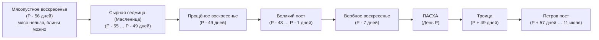

# Исследование R7-00: Интеграция с доставками продуктов и офлайн-расчёт праздников/постов

**Дата исследования:** 2026-11-09  
**Статус:** Выполнено (без изменения программного кода)  
**Цель:** Разведка официальных возможностей интеграции с сервисами доставки («Самокат», «Купер») и математических моделей для автономного (офлайн) расчёта государственных праздников, плавающих церковных событий (Пасха, Масленица) и постов РФ.

---

## 1. Анализ сервисов доставки («Самокат» и «Купер»)

> [!IMPORTANT]
> **Принцип ТЗ и R7:** Никакого парсинга HTML, перехвата сессий, реверс-инжиниринга закрытых мобильных API или обхода систем защиты. Используются исключительно публичные, официально задокументированные механизмы.

### 1.1. Сервис «Самокат» (ООО «Умный ритейл»)

| Параметр | Статус | Официальные факты и ссылки |
| :--- | :--- | :--- |
| **Публичный API для сторонних приложений** | **Не найдено** (отсутствует) | Официального публичного REST/GraphQL API для сторонних разработчиков у «Самоката» нет. Официальный сайт: [samokat.ru](https://samokat.ru/), условия сервиса: [Правила сервиса](https://samokat.ru/rules). Закрытые внутренние эндпоинты (вроде `api.samokat.ru`) в официальной документации **не подтверждены** (документация не публикуется, публичный доступ отсутствует). |
| **Партнёрская программа с API корзины** | **Не найдено** (отсутствует) | Партнёрских программ с API корзины для внешних мобильных приложений нет. Существуют только промокод-акции и B2B-подключение поставщиков товаров на полку: [Правила сервиса](https://samokat.ru/rules). |
| **Веб-поиск по названию продукта через URL** | **Не подтверждено** (отсутствует) | В официальной документации и правилах сервиса [samokat.ru/rules](https://samokat.ru/rules) публичный формат URL для поиска товаров по названию не описан. Наблюдения за веб-версией (SPA без сохранения GET-параметров в адресной строке) официальными источниками **не подтверждены**. |
| **Deep Link в мобильное приложение** | **Не подтверждено** | Официальная документация схем диплинков или App Links для сторонних разработчиков отсутствует. Утверждения о структуре ссылок на карточки товаров (`product/<id>`) и об отсутствии текстового поиска по ссылкам официально сервисом **не подтверждены**. |

**Вывод по «Самокату»:**  
Официальных задокументированных способов интеграции (API, поиск по ссылке, диплинки) **нет** (всё помечено как «не найдено» или «не подтверждено»). Попытки реверс-инжиниринга или парсинга запрещены правилами сервиса и принципами ТЗ.  
Единственный легальный и надёжный способ взаимодействия в R7-09 — **экспорт списка недостающих продуктов в виде структурированного текста через системный диалог «Поделиться»** (`Share.share(...)`).

---

### 1.2. Сервис «Купер» (бывший «СберМаркет», ООО «Инстамарт Сервис»)

| Параметр | Статус | Официальные факты и ссылки |
| :--- | :--- | :--- |
| **Публичный API для клиентских приложений** | **В разработке** (недоступен публично) | На официальном портале документации [docs.kuper.ru](https://docs.kuper.ru/) описан раздел **Client apps API**, предназначенный для создания клиентских приложений (авторизация, поиск, корзина, оформление заказов). **Однако официальная документация прямо фиксирует:** *«на текущий момент данный раздел API находится в разработке и еще не является действующим полноценным API-контрактом»*. Доступ предоставляется только юрлицам по запросу на `new.partners@sbermarket.ru` или `kuper-api@kuper.ru`. |
| **Партнёрская программа** | **Только CPA/B2B** (без API корзины) | Доступны партнёрские CPA-программы в рекламных сетях (привлечение по реферальным ссылкам и промокодам). Партнёрского API для программной сборки корзины из мобильных приложений нет. |
| **Веб-поиск по названию продукта через URL** | **Не подтверждено** | В официальной документации [docs.kuper.ru](https://docs.kuper.ru/) формат веб-поиска по URL `https://kuper.ru/search?query=<текст>` не задокументирован как публичный API или контракт для разработчиков. Он является наблюдаемым форматом адресной строки веб-версии, но официальной страницы документации на него нет. |
| **Deep Link в мобильное приложение (App Links)** | **Не подтверждено** | В официальной документации [docs.kuper.ru](https://docs.kuper.ru/) отсутствуют спецификации App Links / Universal Links или схем диплинков для сторонних приложений. Перехват ссылок системным фильтром приложения «Купер» официально не специфицирован и **не подтверждён**. |

**Вывод по «Куперу»:**  
1. Полноценное API создания корзины откладывается до официального выхода раздела *Client apps API* из статуса «в разработке» и согласования B2B-договора.
2. В задаче R7-09 реализуем открытие ссылки `https://kuper.ru/search?query=${Uri.encodeComponent(ingredient)}` **в браузере через `url_launcher` без обещания открыть мобильное приложение** (так как App Links официально не задокументированы и помечены «не подтверждено»).
3. Проверка того, откроет ли система ссылку в браузере или перехватит в установленное приложение «Купер», выносится в **отдельный пункт проверки для владельца на реальном телефоне**.

---

## 2. Офлайн-расчёт праздников и постов РФ

Приложение работает локально и без сети, поэтому календарные поводы и ограничения питания должны рассчитываться автономно на чистом Dart без внешних сетевых запросов.

### 2.1. Фиксированные государственные праздники РФ
Официально установлены **Статьей 112 Трудового кодекса РФ** (источник: [КонсультантПлюс / ТК РФ ст. 112](https://www.consultant.ru/document/cons_doc_LAW_34683/941bc4d9751e3608be04e6c35c6020c028a396e9/), [Официальный интернет-портал правовой информации pravo.gov.ru](http://pravo.gov.ru/)):

1. **1, 2, 3, 4, 5, 6 и 8 января** — Новогодние каникулы.
2. **7 января** — Рождество Христово.
3. **23 февраля** — День защитника Отечества.
4. **8 марта** — Международный женский день.
5. **1 мая** — Праздник Весны и Труда.
6. **9 мая** — День Победы.
7. **12 июня** — День России.
8. **4 ноября** — День народного единства.

**Кулинарно значимые фиксированные даты традиционного календаря:**
- **31 декабря – 1 января** — Новый год (праздничные салаты, горячее, десерты).
- **13–14 января** — Старый Новый год (традиция лепки вареников, кутья).
- **18–19 января** — Крещенский сочельник и Крещение Господне (постный сочельник, постные блюда).
- **14 августа** — Происхождение честных древ Животворящего Креста Господня / Медовый Спас (выпечка с мёдом и маком, начало Успенского поста).
- **19 августа** — Преображение Господне / Яблочный Спас (яблочные пироги, шарлотки, запечённые яблоки; в Успенский пост разрешена рыба).
- **29 августа** — Ореховый / Хлебный Спас (ореховая выпечка, свежий хлеб).
- **1 сентября** — День знаний (детские праздничные блюда, пироги).

---

### 2.2. Математический алгоритм вычисления даты православной Пасхи (Пасхалия)

Православная Пасха исчисляется по **Александрийской пасхалии** (юлианский календарь) и переводится в даты гражданского григорианского календаря.  
Официальный богослужебный первоисточник: [Календарь Русской Православной Церкви — Издательство Московской Патриархии (patriarchia.ru)](http://www.patriarchia.ru/).

Для автономного программного расчёта используется **модифицированный алгоритм Гаусса для Александрийской пасхалии**.

#### Алгоритм для года $Y$:
1. $a = Y \pmod{19}$ (лунный метонов цикл)
2. $b = Y \pmod{4}$ (цикл високосных лет)
3. $c = Y \pmod{7}$ (цикл дней недели)
4. $d = (19 \cdot a + 15) \pmod{30}$ (пасхальное полнолуние)
5. $e = (2 \cdot b + 4 \cdot c + 6 \cdot d + 6) \pmod{7}$ (поправка на воскресенье)
6. $f = d + e$
7. Дата по старому стилю (юлианскому календарю):
   - Если $f \le 9$: дата = $(22 + f)$ марта.
   - Если $f > 9$: дата = $(f - 9)$ апреля.
8. **Перевод в григорианский календарь (новый стиль):**  
   Для XX и XXI веков (1900–2099 гг.) разница между юлианским и григорианским календарями составляет ровно **+13 дней**.

#### Проверка алгоритма на контрольных годах:
- **2024 год:**  
  $a=10, b=0, c=1 \implies d=25, e=6 \implies f=31 > 9 \implies$ 22 апреля ст. ст. $+ 13$ дней = **5 мая 2024 г.** *(верно)*
- **2025 год:**  
  $a=11, b=1, c=2 \implies d=14, e=2 \implies f=16 > 9 \implies$ 7 апреля ст. ст. $+ 13$ дней = **20 апреля 2025 г.** *(верно)*
- **2026 год:**  
  $a=12, b=2, c=5 \implies d=3, e=6 \implies f=9 \le 9 \implies$ 31 марта ст. ст. $+ 13$ дней = **12 апреля 2026 г.** *(верно)*
- **2027 год:**  
  $a=13, b=3, c=6 \implies d=22, e=3 \implies f=25 > 9 \implies$ 16 апреля ст. ст. $+ 13$ дней = **2 мая 2027 г.** *(верно)*
- **2028 год:**  
  $a=14, b=0, c=0 \implies d=11, e=4 \implies f=15 > 9 \implies$ 6 апреля ст. ст. $+ 13$ дней = **16 апреля 2028 г.** *(верно)*

---

### 2.3. Плавающие праздники и посты, привязанные к Пасхе ($P$)

Все переходящие события вычисляются простым смещением в днях от полученной даты Пасхи ($P$):

1. **Мясопустное воскресенье (Неделя о Страшном Суде):**
   - Точная дата: ровно **$(P - 56)$** дней (за 8 недель до Пасхи, воскресенье).
   - **Кулинарная специфика:** Отдельный день-повод — «мясо нельзя, блины можно» (заговенье на мясо, подготовка к Масленице).
2. **Масленица (Сырная седмица):**  
   - Период: с понедельника **$(P - 55)$** по воскресенье **$(P - 49)$** включительно (7 дней: $P-55 \dots P-49$).
   - Воскресенье $(P - 49)$ — Прощёное воскресенье (Неделя сыропустная).
   - **Кулинарная специфика:** Блины, оладьи, сыр, творог, сметана, яйца, сливочное масло, рыба. Мясо исключено уставом («сыропустная неделя»).
   > [!NOTE]
   > **Указание к реализации R7-03:** При разработке модуля `HolidayCalculator` и тестов к нему формулу и проверки строить строго с учётом этого разделения: день $P - 56$ идентифицируется как «Мясопустное воскресенье», а диапазон с $P - 55$ по $P - 49$ — как «Масленица (Сырная седмица)».
3. **Великий пост:**  
   - Начало: Чистый понедельник, **$(P - 48)$** дней.
   - Окончание: Великая суббота, **$(P - 1)$** день.
   - Длительность: 48 дней.
   - **Ограничения:** Исключение мясных, молочных продуктов, яиц.
   - **Рыбные дни в Великий пост:**
     - Благовещение Пресвятой Богородицы (7 апреля, фиксированная дата, если не приходится на Страстную седмицу).
     - Лазарева суббота: $(P - 8)$ дней (разрешена рыбная икра).
     - Вербное воскресенье (Вход Господень в Иерусалим): $(P - 7)$ дней (разрешена рыба).
4. **Пасхальная (Светлая) седмица:**  
   - С $P$ по $(P + 6)$ дней. Праздничная трапеза, снятие ограничений, поста в среду и пятницу нет.
5. **День Святой Троицы (Пятидесятница):**  
   - Воскресенье, ровно **$(P + 49)$** дней (50-й день Пасхи).
   - Троицкая седмица: с $(P + 49)$ по $(P + 55)$ дней (сплошная седмица, поста в среду и пятницу нет).
6. **Петров (Апостольский) пост:**  
   - Начало: понедельник через неделю после Троицы — **$(P + 57)$** дней.
   - Окончание: **11 июля включительно** (накануне дня святых апостолов Петра и Павла 12 июля — фиксированная дата).
   - Длительность переменная: от 8 до 42 дней в зависимости от даты Пасхи. Разрешена рыба во все дни, кроме среды и пятницы.

---

### 2.4. Фиксированные посты и постные дни

1. **Успенский пост:**  
   - Фиксированные даты: **с 14 по 27 августа** (14 дней).
   - 19 августа (Яблочный Спас / Преображение) — разрешена рыба.
2. **Рождественский (Филиппов) пост:**  
   - Фиксированные даты: **с 28 ноября по 6 января** (40 дней).
   - 6 января — Рождественский сочельник (строгий пост, сочиво/кутья).
3. **Однодневные посты:**
   - 18 января — Крещенский сочельник.
   - 11 сентября — Усекновение главы Иоанна Предтечи.
   - 27 сентября — Воздвижение Креста Господня.
4. **Еженедельные постные дни:**  
   - Каждая **среда** и **пятница** года (растительная пища, при нестрогом посте допускается рыба), **за исключением сплошных седмиц**:
     - Святки: 7–17 января.
     - Мытаря и фарисея: за 3 недели до Великого поста ($(P - 70)$ … $(P - 64)$ дней).
     - Сырная (Масленица): $(P - 55)$ … $(P - 49)$ дней (без мяса, но молоко, сыр, яйца, рыба разрешены; заговенье на мясо в воскресенье $P - 56$).
     - Светлая (Пасхальная): $P$ … $(P + 6)$ дней.
     - Троицкая: $(P + 49)$ … $(P + 55)$ дней.

---

## 3. Архитектурное решение: Что делаем в R7, а что откладываем

### 3.1. Что делаем сейчас (в рамках этапа R7)

1. **Таксономия блюд (R7-01):**
   - Ровно 1 раздел (`dish_group`) из 11 базовых: `baking`, `meat`, `fish_seafood`, `vegetable`, `soup`, `porridge_side`, `salad_snack`, `egg_dairy`, `dessert`, `beverage`, `preserves`.
   - Кухня мира (`cuisine`): `ru`, `it`, `ge`, `uz`, `fr`, `cn`, `jp`, `tr`, `home`.
   - Диетические теги: `vegetarian`, `vegan`, `lenten` (постное), `low_calorie` ($\le 350$ ккал/порция), `gluten_free`, `lactose_free`, `high_protein`.
2. **Автономный календарный модуль `HolidayCalculator` и контекст дня `DayContext` (R7-03):**
   - Расчёт даты Пасхи по формуле Гаусса на чистом Dart.
   - Вычисление плавающих дат: Мясопустное воскресенье ($P - 56$, отдельный день: «мясо нельзя, блины можно»), Масленица (Сырная седмица, $P - 55 \dots P - 49$), Великий пост ($P - 48 \dots P - 1$), Вербное воскресенье ($P - 7$), Троица ($P + 49$), Петров пост ($P + 57 \dots 11$ июля).
   - База фиксированных праздников и постов в локальном JSON-ассете `assets/seed/holidays_ru.json`.
   - Определение повода дня и окна «за 0–3 дня до события» для формирования тематических подборок ленты.
3. **Локальный алгоритм ранжирования ленты `FeedRanker` (R7-05):**
   - Жёсткая фильтрация аллергенов и нелюбимых продуктов до скоринга.
   - Детерминированный подсчёт очков на базе вкуса, повода дня, сезона, настроения и наличия продуктов дома.
   - Разнообразие (MMR, не более 2 блюд одной категории подряд) и блок «Попробуйте новое» (15%).
   - Понятные бабушке текстовые объяснения причин рекомендации («Скоро Масленица», «Вы любите грибы», «Все продукты есть дома») без вызова ИИ.
4. **Недостающие продукты и доставка в R7-09:**
   - **Основной надёжный вариант для всех доставок:** кнопка «Чего не хватает» рассчитывает точный список недостающих ингредиентов с количеством и предлагает действие **«Поделиться списком»** через стандартный системный диалог Android (`Share.share(...)`). Список можно в 1 клик отправить родственникам в Telegram/WhatsApp/SMS или сохранить в заметки.
   - **Для «Купера»:** кнопка **«Искать в Купере»** открывает веб-поиск по ссылке `https://kuper.ru/search?query=${Uri.encodeComponent(ingredientName)}` **в браузере через `url_launcher` без обещания открыть приложение** (в официальной документации App Links не подтверждены; проверка перехвата приложением на телефоне — отдельный пункт для владельца).
   - **Для «Самоката»:** официальных диплинков и поиска по ссылке нет (не подтверждено) — вывод информационного диалога со списком продуктов и предложением отправить его близким через системный диалог «Поделиться».

### 3.2. Что откладываем

1. **Client apps API Купера:** Откладываем до официального выхода раздела из статуса «в разработке», публикации рабочего контракта и согласования коммерческого соглашения с партнёрским отделом.
2. **Автоматическое наполнение корзины и оплата заказа:** Откладываем. Ввод учетных данных бабушки, передача банковских карт или токенов авторизации противоречит требованиям к простоте, надёжности и безопасности приложения.
3. **Интеграция с закрытыми API «Самоката»:** Исключена категорически (отсутствуют открытые API, парсинг запрещён).
